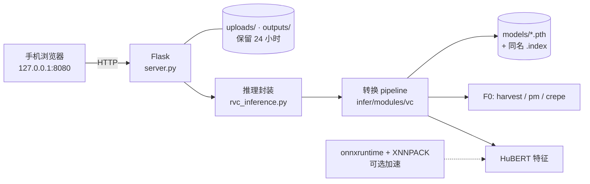

# RVC Android 翻唱工具

在 Android 手机上离线跑 RVC 翻唱：Termux 里用 proot-distro 装一个 Ubuntu 22.04，PyTorch 做 CPU 推理，Flask 提供网页界面——手机浏览器上传一段干声，就能换成目标音色并下载 WAV。

- **纯离线**：不连云端，音频不出手机
- **免 root**：靠 proot 在用户态跑完整 Ubuntu
- **免 GPU**：CPU 推理，按手机内存自动选择低内存参数
- **网页操作**：选模型、传音频、调参、试听、下载，一个页面搞定
- **一键部署**：`install.sh` 装环境，`backup.sh` / `restore.sh` 做整机迁移
- **可选 ONNX 加速**：把 HuBERT 与 Synthesizer 导出成 ONNX，用 onnxruntime 的 XNNPACK EP 跑，速度通常快于纯 PyTorch CPU

> 仅供个人学习与自娱自乐，请勿用于冒充他人、诈骗或未经授权的商业用途。

## 目录

- [整体架构](#整体架构)
- [仓库结构](#仓库结构)
- [快速开始：普通用户（恢复备份包）](#快速开始普通用户恢复备份包)
- [快速开始：开发者（源码安装）](#快速开始开发者源码安装)
- [模型文件](#模型文件)
- [ONNX 加速（可选）](#onnx-加速可选)
- [Web 界面与参数](#web-界面与参数)
- [打包分发给别人](#打包分发给别人)
- [常见问题](#常见问题)
- [性能与限制](#性能与限制)
- [技术栈](#技术栈)
- [声明与许可](#声明与许可)

## 整体架构



Termux 只负责提供 proot 环境和启动入口；真正的代码与依赖都在容器里，`install.sh` 会把本仓库整体复制到容器的 `/root/rvc-app`，之后由容器内的 `python3.10` 执行。

## 仓库结构

仓库根目录就是应用本体；脚本按**自身所在目录**取源码，整个文件夹放哪、叫什么名字都行：

```
.
├── server.py              # Flask 服务：页面 + /api/models /api/convert /api/download
├── rvc_inference.py       # 模型加载、索引关联、ONNX/PyTorch 切换、转换入口
├── onnx_engine.py         # onnxruntime 封装（HuBERT / Synthesizer，XNNPACK EP）
├── export_onnx.py         # 在 PC 上把 .pth 导出为 ONNX 的工具
├── infer/                 # RVC 推理核心（上游代码精简，仅保留推理）
│   ├── lib/               # 网络结构、HuBERT/RMVPE 加载、音频 IO、F0 预测器
│   └── modules/vc/        # 转换 pipeline 与工具函数
├── assets/
│   ├── hubert/            # hubert_base.pt、hubert_layer9/12.onnx（不入库）
│   └── rmvpe/             # rmvpe.pt（不入库）
├── models/                # 音色模型 .pth / .index / .onnx
├── templates/index.html   # 页面
├── static/css|js/         # 前端资源
├── requirements.txt       # 固定版本的 Python 依赖
├── install.sh             # 一键安装（Termux → proot Ubuntu → 依赖 + 权重）
├── start.sh               # 启动服务（默认 8080）
├── backup.sh              # 把装好的环境打成可分发备份包
├── restore.sh             # 在目标手机一键恢复并配置自启动
├── .gitattributes         # 强制 LF，避免 Windows 克隆后脚本带 CRLF
├── .gitignore
├── LICENSE                # GPL-3.0
├── THIRD_PARTY_NOTICES.md # 第三方代码与模型声明
└── README.md
```

`assets/hubert/`、`assets/rmvpe/` 下的 `.gitignore` 内容都是 `*` + `!.gitignore`，所以两个大权重不会进仓库；`models/kikiV1.pth`（约 52 MB）作为示例音色入库。

## 快速开始：普通用户（恢复备份包）

不需要懂 Linux，环境全在备份包里。

**前提**

| 项目 | 要求 |
|------|------|
| 设备 | ARM64（arm64-v8a）Android 手机 |
| 系统 | Android 7.0 及以上 |
| 存储 | 建议预留 **≥ 5 GB**（备份包约 1.8 GB，解压后约 3 GB） |
| 网络 | 下载备份包时用 WiFi，之后可完全离线 |

**步骤**

1. 准备好三样东西：配套的 `Termux.apk`、环境备份包 `rvc-termux-backup-*.tar.gz`、`restore.sh`。
   发布者通常会一并提供（体积大，视发布渠道而定）；也可以让已经装好环境的人用 [backup.sh](#打包分发给别人) 打一个给你。
2. 把 `.tar.gz` 和 `restore.sh` 放进手机 **Download / 下载** 目录，**不要解压**。
3. 安装 `Termux.apk`（允许"未知来源"），打开一次 Termux 等它初始化完成。
4. 授权存储：

   ```bash
   termux-setup-storage
   ```

   弹窗点【允许】。
5. 运行恢复脚本，中途保持屏幕常亮：

   ```bash
   bash /sdcard/Download/restore.sh
   ```

6. 脚本会校验并解压环境，并把"打开 Termux 自动启动服务"写进 `~/.bashrc`。完成后 `exit`，重新打开 Termux，等 10~30 秒加载模型。
7. 手机浏览器打开 **http://127.0.0.1:8080**。

同一 WiFi 下的电脑/平板也能访问：打开 `http://<手机局域网IP>:8080`，IP 会打印在 Termux 里。

## 快速开始：开发者（源码安装）

想改代码、换模型、自己打包分发时走这条路。

### 1. 准备 Termux 与代码

```bash
pkg install git -y        # Termux 默认没装 git
termux-setup-storage      # 可选：只有用 Download 里的本地镜像/权重时才需要
git clone https://github.com/fdhxk/Android-RVC.git ~/Android-RVC
cd ~/Android-RVC
```

clone 后直接进目录跑脚本即可；脚本以**自身所在目录**作为源码目录，整个文件夹放哪、叫什么名字都行。

国内 `git clone` 被重置时可以换镜像，或者直接在电脑上点 Code → Download ZIP、解压后整个文件夹拷进手机（ZIP 方式不用装 git）：

```bash
git clone https://ghfast.top/https://github.com/fdhxk/Android-RVC.git ~/Android-RVC
```

### 2. 装环境（权重自动下载）

```bash
termux-wake-lock   # 防止安装途中锁屏被系统杀掉，装完可 termux-wake-unlock
bash install.sh
```

首次约下载 1.7 GB，10~30 分钟：

| 阶段 | 内容 |
|------|------|
| 1 | `pkg update`，安装 `proot-distro`、`curl`、`tar`、`coreutils` |
| 2 | 装 Ubuntu 22.04 rootfs（约 500 MB，优先用 Download 里的本地镜像，没有再在线下载） |
| 3 | 把仓库代码复制进容器 `/root/rvc-app`（排除 `.git`、`__pycache__`、`uploads/`、`outputs/`，已有权重先挪出再放回） |
| 4 | 补齐预训练权重 `hubert_base.pt`（约 181 MB，必需）：容器内已有 → 源码目录 → 手机 Download → hf-mirror → HuggingFace，逐级回退 |
| 5 | 容器内换华为云源，`apt` 装 `python3.10 / pip / ffmpeg / libsndfile1 / build-essential` |
| 6 | 固定 `pip==24.0`，按 `requirements.txt` 装依赖（CPU 版 PyTorch 2.3.1、fairseq、faiss、onnxruntime 等） |

`rmvpe.pt`（可选，约 173 MB）默认不下载，需要时用 `INSTALL_RMVPE=1 bash install.sh`。网页当前只开放 harvest / pm / crepe 三种音高，这个文件平时用不上。

网络不稳时可以把 `hubert_base.pt` 手动下载到手机 Download 目录，脚本会直接复制过去，不再走网络。

中断了可以直接重跑，已完成的步骤会跳过。国内网络下 Ubuntu 镜像有时拉不动，可以自己在电脑上下载 `ubuntu-22.04-server-cloudimg-arm64-root.tar.xz` 放进 Download，脚本会自动优先用本地文件。

### 3. 启动

```bash
bash start.sh          # 默认 8080
bash start.sh 8081     # 换端口
```

浏览器访问 `http://127.0.0.1:8080`。`start.sh` 会先检查容器和 `hubert_base.pt` 是否就绪，缺东西会直接告诉你缺什么。

想在同一个 WiFi 的电脑/平板上访问，先 `pkg install net-tools`：脚本用 `ifconfig` 取局域网 IP，没有这个命令就只会打印 `localhost`（本机访问不受影响）。

### 4. 改完代码

容器里的代码是**复制**进去的，不是挂载。改完源码要重新同步一次：

```bash
bash install.sh
```

它会重新复制代码、清空容器内的 `uploads/`、`outputs/`（等同一次干净重启），已有的权重会跳过不重复下载。

## 模型文件

| 文件 | 体积 | 必需 | 放哪 | 说明 |
|------|------|------|------|------|
| `hubert_base.pt` | 180.7 MiB | **必需** | `assets/hubert/` | HuBERT 特征提取，缺失时报 `HuBERT模型不存在` |
| `rmvpe.pt` | 172.8 MiB | 可选 | `assets/rmvpe/` | RMVPE 音高，pipeline 支持但当前网页只开放 harvest / pm / crepe |
| `*.pth` | 通常 50~200 MB | 按需 | `models/` | RVC 音色模型，v1 / v2 都支持 |
| `*.index` | 几 MB~几十 MB | 可选 | `models/` | FAISS 索引，与模型**同名**（`kikiV1.index`）时自动启用 |
| `*.onnx` | 视模型 | 可选 | `models/`、`assets/hubert/` | ONNX 加速用，见下一节 |

表格前两行是预训练权重：`hubert_base.pt` 由 `install.sh` 自动下载（优先国内镜像 `hf-mirror.com`，失败再走 HuggingFace），不需要手动找。想自己下也可以，地址是 `https://hf-mirror.com/lj1995/VoiceConversionWebUI/resolve/main/hubert_base.pt`，放到 `assets/hubert/` 或手机 Download 目录均可。音色模型用 RVC 训练产物，也可以启动后直接在网页上传。

> 只有放进**源码目录** `models/` 的文件才会在下次 `install.sh` 时同步进容器。环境已装好、只想临时加模型的话，用网页的"上传新模型"更省事——文件直接落在容器内并立刻可选。

## ONNX 加速（可选）

默认走 PyTorch。想更快，可以在 PC 上把模型导出成 ONNX，再用 onnxruntime 的 XNNPACK EP 推理：

```bash
# PC 上，在本仓库目录执行（需要 torch + fairseq）
python export_onnx.py --model models/kikiV1.pth --out-dir onnx_out
```

产物这样放：

| 产物 | 放到 |
|------|------|
| `hubert_layer9.onnx`、`hubert_layer12.onnx` | `assets/hubert/` |
| `<模型名>.onnx`（与 `.pth` 同名） | `models/` |

放好后无需改配置：`rvc_inference.py` 检测到 `assets/hubert/hubert_layer9.onnx` 就自动启用 ONNX，并对每个模型查找同名 `.onnx`；找不到就自动回退 PyTorch，不会报错。ONNX 模式固定用 CPU + XNNPACK。

只导出其中一部分时用 `--only hubert` 或 `--only synth`。

## Web 界面与参数

1. **选模型**：下拉框列出 `models/` 下所有 `.pth`，右侧 ⟳ 刷新；也可拖拽上传新的 `.pth`（单文件上限 1 GB）。
2. **传音频**：支持 `wav / mp3 / flac / ogg / m4a / aac`，单文件上限 1 GB。
3. **调参**（见下表），点"开始翻唱"。
4. **下载**：输出固定为 WAV，采样率跟随模型（v2 模型常见 40k / 48k）。

| 参数 | 范围 | 默认 | 作用 |
|------|------|------|------|
| 变调 key | -12 ~ +12 半音 | 0 | 男→女常用 +12，女→男常用 -12，同性别 ±2~±4 更自然 |
| 音高提取 method | harvest / pm / crepe | harvest | harvest 最稳，pm 最快，crepe 质量好但慢 |
| 索引匹配率 index_rate | 0 ~ 1 | 0.66 | 越高越像目标音色，过高会吞咬字，常用 0.5~0.8 |
| 滤波半径 filter_radius | 0 ~ 7 | 3 | 对 F0 做中值滤波，杂音多时调高 |
| RMS 混合率 rms_mix_rate | 0 ~ 1 | 1.0 | 1.0 跟随原音频响度起伏 |
| 保护参数 protect | 0 ~ 0.5 | 0.33 | 保护清辅音与气声，防电音，过大会保留原音色 |

上传的音频与输出文件在 24 小时后自动清理（每次启动服务时清一次）。转换期间别刷新页面。

## 打包分发给别人

在**已装好环境**的手机上打包：

```bash
bash backup.sh          # 完整版（默认），含 hubert / rmvpe，约 1.8~2 GB
bash backup.sh 精简     # 精简版，不含两个权重，体积小
```

产物在手机 `Download/rvc-termux-backup-<日期>.tar.gz`，打包耗时 10~30 分钟，保持屏幕常亮。

把「备份包 + `restore.sh` + `Termux.apk`」发给对方，让他按[普通用户流程](#快速开始普通用户恢复备份包)操作即可。

## 常见问题

<details>
<summary><b>Ubuntu 镜像下载不动 / 超时</b></summary>

国内连 Docker Hub 经常超时。电脑上下载 `ubuntu-22.04-server-cloudimg-arm64-root.tar.xz` 放进手机 Download，重跑 `install.sh`，脚本会自动本地导入。
</details>

<details>
<summary><b>pip 报 <code>No module named 'yaml'</code> 或 blinker / metadata 错误</b></summary>

`omegaconf 2.0.x` 声明了不合规的 `PyYAML (>=5.1.*)`，新版 pip 会拒绝解析。`install.sh` 已固定 `pip==24.0`、显式装 PyYAML、对预装 blinker 使用 `--ignore-installed`；手工装依赖时照做即可。
</details>

<details>
<summary><b>转换报 <code>HuBERT模型不存在</code></b></summary>

`assets/hubert/hubert_base.pt` 没放对。按[模型文件](#模型文件)放好后重跑 `install.sh`，或改用网页上传模型。
</details>

<details>
<summary><b>下拉框里看不到我放的 .pth</b></summary>

点 ⟳ 刷新；确认文件名以 `.pth` 结尾、不含空格和特殊字符。环境装好后往源码目录加模型，需要重跑 `install.sh` 才会同步进容器。
</details>

<details>
<summary><b>Termux 切后台就被杀</b></summary>

系统设置里给 Termux 关掉电池优化、允许后台运行；Termux 内执行 `termux-wake-lock`；使用时别清理 Termux 窗口。
</details>

<details>
<summary><b>8080 端口被占用</b></summary>

`bash start.sh 8081`，然后访问 `http://127.0.0.1:8081`。
</details>

<details>
<summary><b>电脑打不开手机上的页面</b></summary>

确认在同一 WiFi；用 `start.sh` 打印的局域网地址；部分路由器的 AP 隔离会挡住互访。
</details>

<details>
<summary><b>ONNX 没生效</b></summary>

检查 `assets/hubert/hubert_layer9.onnx` 是否存在、模型旁是否有同名 `.onnx`。缺任意一个都会静默回退 PyTorch；服务器日志里会打印 `ONNX加速: True/False`。
</details>

## 性能与限制

- **仅 CPU 推理**：无 CUDA / MPS 时自动回落 CPU，并用低内存分段参数（`x_pad=1, x_query=6, x_center=38, x_max=41`）。手机比电脑慢很多，**建议单段 1~2 分钟以内**。
- **只做离线翻唱**：不含实时变声、训练、批量推理——这些是上游 RVC WebUI 的能力，本项目裁剪掉了。
- **默认监听 `0.0.0.0` 且无鉴权**：同一局域网内谁都能打开 `IP:8080`。公共网络下建议只监听本机：

  ```bash
  proot-distro login ubuntu -- bash -c "cd /root/rvc-app && python3 server.py --host 127.0.0.1 --port 8080"
  ```

- **输出只有 WAV**，不做 mp3 转码；上传/输出文件 24 小时后自动清理。

## 技术栈

| 层 | 组件 |
|----|------|
| 运行环境 | Termux → proot-distro → Ubuntu 22.04 → Python 3.10 |
| 推理 | PyTorch 2.3.1 (CPU) / torchaudio 2.3.1 / fairseq 0.12.2 / faiss-cpu 1.7.3 |
| 可选加速 | onnxruntime ≥ 1.17（XNNPACK EP），ONNX opset 17 |
| 音频 | librosa 0.9.1 / soundfile / av / praat-parselmouth / pyworld / torchcrepe |
| Web | Flask ≥ 2.3 + flask-cors ≥ 4.0，原生 HTML/CSS/JS |

完整版本约束见 [requirements.txt](requirements.txt)。

## 声明与许可

本工具仅供学习研究。**请勿**用于冒充他人、伪造语音诈骗，或未经授权的商业用途；使用后果由使用者自负。

- `infer/` 基于 [RVC-Project/Retrieval-based-Voice-Conversion-WebUI](https://github.com/RVC-Project/Retrieval-based-Voice-Conversion-WebUI)（MIT，Copyright © 2023 liujing04）精简改造，原始声明见 [THIRD_PARTY_NOTICES.md](THIRD_PARTY_NOTICES.md)
- HuBERT、RMVPE 权重版权归各自作者；`models/` 下音色模型版权归对应声源人与训练者
- 本仓库整体以 [GPL-3.0](LICENSE) 发布
